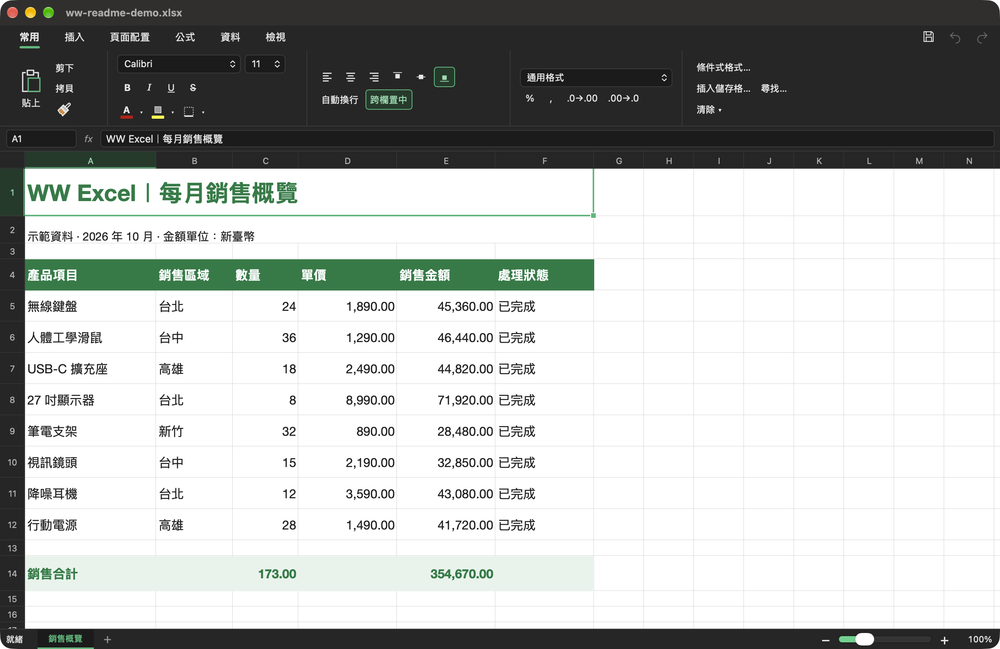

# WW Excel

macOS 原生的試算表 App，目標是提供接近 Microsoft Excel 的操作體驗：熟悉的快捷鍵、公式、格式，並能直接開啟與儲存 `.xlsx`。

以 **Go + Wails3 + Svelte 5 + TypeScript** 開發。資料與運算都在 Go 端，前端用 Canvas 繪製格線，100 萬列也能以 60fps 捲動。



> 上圖為 v1.2.0 介面的實際視窗，使用生成的示範銷售資料，展示 Ribbon 功能區、深色介面與白底工作表。

## v1.2.0 更新

- 新增 Excel 風格 Ribbon 功能區，包含常用、插入、頁面配置、公式、資料與檢視六個分頁，連接既有功能。
- 常用工具依剪貼簿、字型、對齊、數值與編輯功能排列；移除群組底部標籤，縮減工具列高度。
- 儲存、復原與重做位於分頁列右側，文件名稱沿用 macOS 原生標題列。
- 深色模式採用深色工具列及列欄標題，搭配白底、深色文字的工作表；公式列與對話框維持深色，活頁簿儲存的底色與字色不受影響。
- 支援分頁鍵盤切換與窄視窗群組換行。前端 113 項測試、桌面 243 項回歸測試通過。

## v1.1.1 更新

- 更新 Excelize 至固定的官方安全修補版本，排除三項已知漏洞（GO-2026-6684、GO-2026-6688、GO-2026-6689）。
- 修正公式列與編輯模式的日期顯示，保留原日期值與數值格式。
- 修正開啟 Excel 檔時漏讀未帶 `customHeight` 標記的列高。
- 儲存確認視窗使用與 App、Dock 相同的圖示。

## v1.1.0 更新

- 新增工作表縮放控制，可使用滑桿、加減按鈕，或點擊百分比選擇常用比例、自訂比例與選取範圍最適化。
- 新增複製格式刷子，支援拖曳套用、連續套用及跨工作表操作。
- 改善 Excel 檔案顯示：讀取儲存格富文字的分段字色，以及矩形、圓角矩形文字方塊和主題色。
- 更新 App 與 Dock 圖示，並補上「關於 WW Excel」的說明、版本與製作者資訊。
- 狀態列預設隱藏效能量測資訊，開發時可透過 `VITE_PERF_HUD=1` 顯示。

## 下載

到 [Releases](https://github.com/andrewlu0210/ww-excel/releases) 下載最新的 `WW-Excel-x.y.z.dmg`，把 WW Excel 拖進「應用程式」即可。

- 需求：macOS 12 以上，Apple 晶片與 Intel Mac 都可執行（Universal）
- 目前是 ad-hoc 簽章、未經 Apple 公證：第一次開啟請在 app 上按右鍵 › 打開

## 功能

### 介面
- Ribbon 分頁功能區整合常用、插入、頁面配置、公式、資料與檢視功能
- 深淺色介面，工作表維持白底；快捷按鈕與分頁共用一列

### 編輯
- 直接在儲存格輸入，或用公式列編輯；Enter／Tab／方向鍵的行為與 Excel 相同（F2 切換輸入／編輯模式，⌥Enter 換行）
- 中文輸入法（注音、倉頡）從第一個按鍵就能組字，候選字視窗出現在儲存格旁
- 復原／重做（⌘Z／⇧⌘Z），多步驟的操作算一次復原
- 複製格式：先選來源再按工具列刷子，點選或拖曳目標套用；雙擊刷子可連續套用，Esc 取消，可跨工作表操作
- 剪下、拷貝、貼上，可以和 Excel、Numbers、網頁表格互相複製；選擇性貼上（值、格式、公式、轉置、略過空格）
- 填滿控點：自動數列、日期、星期、月份與自訂清單；⌘D／⌘R 向下、向右填滿
- 插入／刪除列與欄，公式參照自動調整（參照失效時顯示 `#REF!`）
- 尋找與取代（可搜尋整本活頁簿）、排序（多層）、自動篩選
- 凍結窗格、隱藏列欄、調整列高欄寬（雙擊自動調整）、合併儲存格
- 工作表縮放（10%–400%）：右下角加減按鈕、滑桿與縮放視窗（常用比例、自訂百分比、選取範圍最適化）；本次開啟期間各工作表分別記住比例

### 公式
- 自己實作的公式引擎，**308 個函數**：數學、統計（含常態、t、卡方、F 等分配）、財務（PMT、IRR、XIRR、折舊…）、邏輯、查閱（VLOOKUP、XLOOKUP、INDEX/MATCH…）、文字、日期與時間、資訊
- 支援 `A1`、`$A$1`、`Sheet2!A1`、`A:A`、陣列常數、具名範圍、表格的結構化參照（`表格1[金額]`、`[@單價]`）
- 增量重算、偵測循環參照；大量獨立的公式會用多顆 CPU 平行計算
- 日期採 Excel 的 1900 序列值，連 1900 閏年的 bug 也照做
- 輸入公式時：參照彩色框、用滑鼠點選參照（point mode）、F4／⌘T 切換 `$`、函數自動完成與參數提示
- 函數結果以真實 Excel 的行為為準，有 400 多個 golden test 案例

### 格式
- 字型、大小、粗體／斜體／底線／刪除線、文字與填滿顏色、框線、對齊、自動換行
- 數值格式：通用、數值、貨幣、會計、日期、時間、百分比、分數、科學記號、自訂格式碼，支援民國年、上午／下午、色彩區段
- 中文字型：蘋方、宋體、楷體、標楷體、儷宋、圓體等都能使用；Excel 檔裡的 Windows 字型（新細明體、微軟正黑體、標楷體）會自動對應到 Mac 上的同類字型
- 條件式格式：比較值、包含文字、前 N 項、高於平均、重複值、公式、色階、資料橫條
- 資料驗證：下拉清單、數值／日期範圍、自訂公式，可設定提示訊息與錯誤提醒

### 資料
- 多工作表：新增、刪除、改名、排序，公式跟著更新
- 具名範圍與名稱管理員、名稱方塊跳轉
- 表格（⌘T）：樣式、合計列、在旁邊輸入會自動擴充
- 註解（⇧F2）

### 圖表與輸出
- 圖表：直條、橫條、折線、區域、圓形、散佈（含堆疊），修改資料時圖表即時更新
- 插入圖片；圖表與圖片可以拖曳移動和縮放
- 版面設定（紙張、方向、縮放、邊界、頁首頁尾、列印範圍）、列印預覽、列印、匯出 PDF

### 檔案
- `.xlsx`：開啟與儲存。**原地存檔**只寫入有變動的部分，所以圖表、註解等不支援的內容不會遺失
- `.csv`，以及自有格式 `.wwx`
- 多視窗（一份文件一個視窗）、最近使用的檔案、從 Finder 開檔或拖到 Dock 圖示

### 其他
- **自動儲存與當機復原**：定期保存未儲存的文件，當機後下次啟動可以復原
- **偏好設定**（⌘,）：外觀（淺色／深色／跟隨系統）、介面語言（繁體中文／English）、Enter 後移動方向、自動儲存間隔、檢查更新
- **VoiceOver**：移動時念出儲存格位址與內容
- 檢查更新：有新版本時提示並開啟下載頁面

## 效能

| 項目 | 結果 |
|---|---|
| 100 萬列捲動 | 60fps |
| 1 萬個公式連鎖重算 | 約 6.5ms |
| 開啟 100 萬格的 xlsx（20 萬個公式） | 約 1.3 秒 |

詳細量測紀錄見 [docs/perf.md](docs/perf.md)。

## 開發

```bash
go install github.com/wailsapp/wails/v3/cmd/wails3@v3.0.0-beta.34
export PATH="$HOME/go/bin:$PATH"

wails3 dev                       # 開發模式（hot reload）
VITE_PERF_HUD=1 wails3 dev       # 顯示狀態列的效能資訊與量測按鈕（預設隱藏）
wails3 build                     # 建置 -> bin/ww-excel
./bin/ww-excel path/to/file.xlsx # 啟動時開啟檔案

go test ./internal/...           # Go 單元測試
cd frontend && npm test          # 前端測試

# 自動編輯測試：用模擬按鍵操作真實的 app，結果寫到 docs/selftest-latest.md
WW_SELFTEST=1 WW_BENCH_OUT="$PWD/docs/selftest-latest.md" ./bin/ww-excel

scripts/package.sh               # 打包 dist/WW Excel.app 與 DMG（UNIVERSAL=1 產生 Universal 版）

# 重新產生 App 圖示（保留 PNG 的透明外框）
wails3 task common:generate:icons -f
```

### 架構

```
Svelte (WKWebView)                      Go
├─ 工具列、公式列、對話框                ├─ Workbook model（稀疏 block 儲存、style table）
├─ Canvas 格線（虛擬化）      ──指令──▶  ├─ Command + Undo/Redo
├─ Block 快取                ◀──差異──  ├─ 公式引擎（parser → AST → 依賴圖 → 重算）
└─ 輸入層（選取、鍵盤、IME）              ├─ xlsx / csv / wwx、PDF
                                        └─ macOS 整合：選單、多視窗、對話框
```

- Go 是唯一的資料來源；前端只快取畫面附近的資料區塊（64×32 格為一個 block）
- 前端只送指令給 Go，Go 用事件推送有變動的儲存格
- 公式引擎自己實作；excelize 只用來寫入 xlsx 和讀取活頁簿層級的資料

架構原則、開發規範與各版本的設計紀錄見 [CLAUDE.md](CLAUDE.md)，需要手動確認的項目見 [docs/manual-checks.md](docs/manual-checks.md)。

## 已知限制

- 沒有動態陣列與溢出（`FILTER`、`SORT`、`UNIQUE`）、`LET`／`LAMBDA`、樞紐分析表、巨集
- 修改過的 Excel 圖表會簡化成這裡支援的格式（顏色、資料標籤等會遺失）
- 匯入的文字方塊目前僅供顯示，尚不能編輯；修改富文字儲存格的內容會清除其分段格式
- 只有 macOS 版
