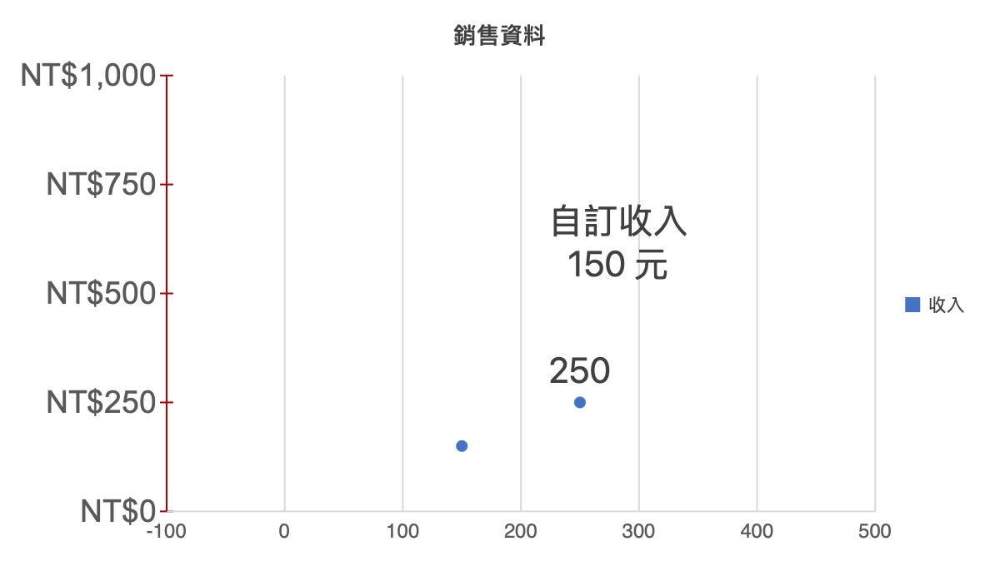

# 圖表座標軸設定

雙擊圖表，在「座標軸設定」選擇要編輯的軸。直條、折線、區域圖提供垂直數值軸與水平類別軸；橫條圖方向相反。組合圖另可切換右側數值軸；散佈圖的 X、Y 都是數值軸。圓形與環圈圖沒有座標軸設定。

數值軸可設定最小值、最大值、主要刻度間距；欄位留白代表自動，最小值必須小於最大值。可只固定其中一側範圍，另一側會自動調整。「恢復自動範圍」只清除範圍與間距，保留字型、格式與其他設定。

所有可編輯軸均可設定數字格式、字型、大小、軸線色彩與刻度線，並分別切換座標軸、刻度標籤、軸線及主要格線的顯示。類別軸沒有數值範圍；數字格式會套用在數字／日期來源，文字類別保持原樣。格式使用與儲存格相同的 Excel 格式碼，例如 `0.0`、`0%`、`"NT$"#,##0`、`yyyy`。

- 左右數值軸各自計算範圍、刻度與格式；散佈圖的 X／Y 軸同樣獨立。
- 欄位變更會更新預覽，按「確定」才套用。整次編輯可一次復原或重做；取消不修改文件。
- 刻度過密時，畫面會以主要刻度間距的整數倍抽稀顯示，限制約 200 個刻度；原始設定仍保留供 XLSX 匯出。
- XLSX／WWX 保留設定；只修改支援的座標軸屬性時，以局部 XML 更新保留原有圖表格式、樣式資源與擴充節點。
- 螢幕預覽及列印／PDF 共用繪製邏輯。

仍未提供對數軸、反向順序、次要格線，以及日期軸的時間單位設定。匯入的未支援屬性會盡可能保留，但畫面不保證完全呈現。實際 Microsoft Excel 互通仍待手動驗收。

## 驗證

Go 測試涵蓋欄位驗證、左右軸與散佈圖刻度、單側自動範圍、密集刻度、各圖表 XLSX／WWX 往返及擴充 XML 保留。前端測試涵蓋格式化刻度、字型、格線、隱藏標籤、橫條圖方向及散佈圖範圍裁切。

使用 `tools/chartlabelfixture` 產生驗收檔後，執行 `WW_SELFTEST=1 WW_XLSX_FIXTURE="$PWD/test_data/chart-labels.xlsx" WW_BENCH_OUT="/private/tmp/chart-axis-selftest.md" ./bin/ww-excel`，會在實際視窗驗證設定、取消、拒絕無效範圍、復原重做、自動範圍、雙軸、散佈圖及存檔重開。
