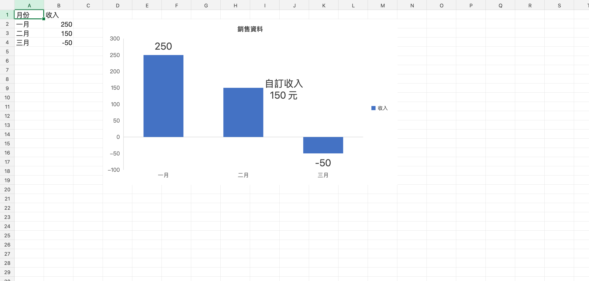

# 進階圖表與資料標籤

雙擊圖表開啟「編輯圖表」，在下方「資料標籤」選擇數列並啟用，即可預覽與套用設定。

- 支援直條、橫條、折線、區域、散佈、圓形、環圈及柱狀＋折線組合圖。
- 可組合數值、百分比、類別與數列名稱，設定分隔符號、數字格式、位置、字型、大小、色彩、粗斜體、旋轉、底色和外框。
- 選擇個別資料點，可隱藏、輸入多行自訂文字、覆寫位置和字型大小／色彩／粗斜體，或以圖表百分比設定水平及垂直位置。環圈標籤可放在中央。
- 取消不修改文件；套用可復原與重做。修改來源儲存格會更新數值標籤；自訂文字保持原樣。
- 螢幕、圖表預覽及列印／PDF 使用相同繪製邏輯。標籤可換行並避開部分重疊，密集資料仍建議隱藏部分標籤或調整個別位置。

## 滑鼠拖曳標籤

啟用資料標籤後，將游標移到標籤文字上，游標會變成抓取手勢。按住滑鼠左鍵拖曳，即可即時調整單一標籤的位置；選取的標籤會顯示虛線框。放開滑鼠才套用，整次拖曳只佔一次復原步驟。

- 直接拖曳標籤文字會移動該資料點的標籤；拖曳圖表空白處仍移動整張圖表。
- 拖曳中按 Escape、指標取消或視窗失焦，會捨棄這次移動；單擊不新增修改。
- 位置以整張圖表的比例儲存，工作表縮放與圖表大小改變後仍使用相對位置。標籤會限制在圖表範圍內，旋轉標籤也會考慮旋轉後的範圍。
- 保留標籤原有文字與樣式；XLSX／WWX 重開及列印／PDF 會沿用新位置。

## 儲存與相容性

XLSX、WWX 保留標籤設定、自訂文字及位置。匯入 XLSX 後，只改圖表標題、圖例、軸標題、數列參照、標籤或物件大小／位置，會在原始圖表 XML 更新對應欄位，保留其他未支援的格式、擴充節點與關聯樣式資源。WWX 也保存這些來源資訊，轉回 XLSX 時沿用。

更換圖表類型、增刪數列等結構變更仍使用重建方式，儲存前會顯示相容性提示。未支援的進階格式可以保留，但不代表畫面能完整呈現。原始自訂標籤文字區段的混合字型，目前無逐區段編輯介面。

真正 Excel 的版面與開啟互通仍須手動確認。

## 驗證

- `go test ./internal/...`：標籤格式、驗證、橋接往返與復原、XML 擴充／樣式資源、軸標題、XLSX → WWX → XLSX。
- `npm --prefix frontend test`、`npm --prefix frontend run check`：各圖表標籤繪製、正負值位置、隱藏、多行、旋轉、個別樣式、命中範圍與拖曳邊界。
- `go run ./tools/chartlabelfixture` 產生 `test_data/chart-labels.xlsx`。
- `WW_SELFTEST=1 WW_XLSX_FIXTURE="$PWD/test_data/chart-labels.xlsx" WW_BENCH_OUT="$PWD/docs/chart-label-selftest.md" ./bin/ww-excel` 執行實際視窗驗收（模擬指標事件），包含捲動與 150% 縮放、取消、復原重做及拖曳後重開。
