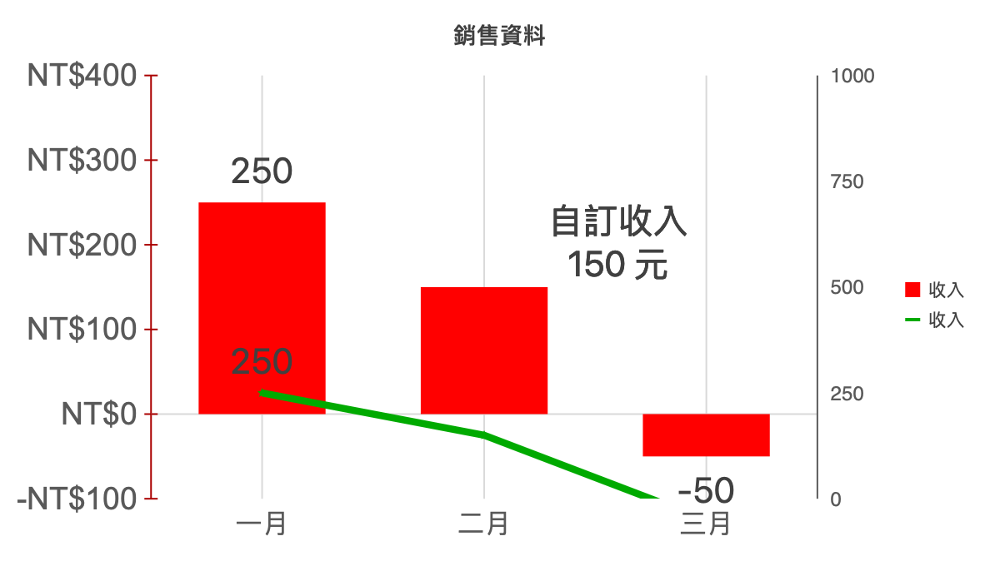

# 圖表數列外觀

雙擊圖表，在「數列外觀」選取數列後調整色彩。「預設色彩」使用該數列順序的預設配色。折線粗細可設為 0.25–30 像素；折線與散佈圖可選擇自動、不顯示、圓形、方形、菱形、三角形、叉號、加號、星形、短線或圓點標記。

直條、橫條與組合圖可設定柱距 0–500%，留白使用自動值（150%）；環圈圖可設定內徑 10–90%。圓形與環圈圖目前保留原有各區塊配色，沒有個別區塊選色介面。

變更即時顯示預覽，按「確定」才套用；取消不修改文件，整次編輯可一次復原或重做。設定會保存於 XLSX／WWX，畫面、列印與 PDF 使用相同繪製邏輯。匯入圖表的支援屬性以局部 XML 更新，保留未修改的樣式、圖片標記與擴充資源；更換圖表類型、增刪數列等結構變更仍可能重建圖表並提示相容性影響。

## 驗證

Go 測試涵蓋數值驗證、不同圖表類型、數列對應、原始擴充保留、XLSX／WWX 往返與新建散佈圖。前端測試涵蓋各種標記形狀。原生視窗合併驗收 45 項，包含標籤、座標軸、數列色彩、線寬、星形標記、柱距、環圈內徑、取消、復原與存檔重開；詳見 [驗收紀錄](chart-axis-selftest.md)。PDF 已輸出並轉為影像檢查，中文標籤、雙軸及數列外觀完整。真正 Microsoft Excel 開啟、重存與外觀比對仍待人工驗收。

